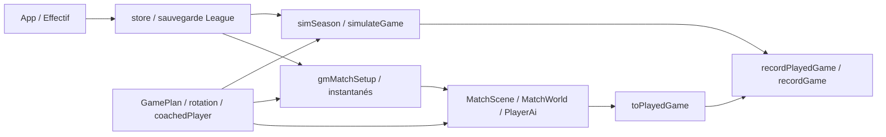

# Refonte management — première tranche du §19

> Ce rapport décrit la première livraison (lots 0 et 1 partiel). La suite finalise le lot 1 et livre le lot 2 : [bilan à jour](COACHING_LOTS_1_2.md).

Travail du 15 novembre 2026, checkout `work` basé sur `1308db4` (dépôt sélectionné sur `main`). Comparaison avec la description de l’archive dans le cahier des charges fourni ; l’archive ZIP elle-même n’est pas disponible ici. Aucun code tiers ni dépendance ajouté.

## Audit initial et frontières

Les chemins de l’audit sont présents : `types`, `coach`, `rotation`, `simGame`, `simSeason`, `offseason`, `migrate`, `store`, `gameResult`, `MatchWorld`, `playerAi`, `RosterTab`. Les limites décrites sont confirmées : rotation par rang, absence de plans persistants, commande de rotation sans validation, reconduction automatique des contrats. La calibration et les 383 tests existants passent au départ ; seul avertissement de build : gros chunk Phaser.

Écarts/documentation à interpréter : `CLAUDE.md` et les premières parties du contrat moteur/vue disent encore que le match jouable reste à construire ou décrivent le 1v1 historique. Le code contient déjà les matchs 5v5, leurs statistiques, la rotation partagée et les corrections du 13 novembre. Le `MatchSetup` est dans `src/match/gameResult.ts`, pas dans un fichier `match/types.ts`. La clé de sauvegarde est bien `hoopsim.save.v1` ; aucun schéma explicite avant cette tranche. Aucun backend, marché ou système tactique collectif complet n’est présent.

`recordGame` reste la voie existante de comptabilisation. Aucun résultat de match physique n’est remplacé par une simulation rapide. Les sprites, animations, caméra, terrain, physique et commandes clavier ne sont pas modifiés.

## LOT 0 — Audit, sécurité et modèle

État : TERMINÉ pour le socle de cette tranche.

1. **Fonctionnement** : les 30 équipes reçoivent un plan équilibré. Une ancienne carrière chargée sous la même clé est migrée vers `schemaVersion: 2`. Les identifiants, fiches, contrats, stats, calendrier et état RNG sont préservés. La migration est idempotente. Un effectif comportant moins de cinq aptes conserve la carrière et produit un avertissement ; lancer un match GM signale une erreur récupérable.
2. **Fichiers** : `engine/gamePlan.ts` définit types, valeurs par défaut, répartition bornée, validation et réparation ; `types.ts`, `generate.ts`, `coach.ts`, `migrate.ts`, `index.ts` raccordent le cycle de ligue. `gamePlan.test.ts` couvre anciennes données normales, blessures/transferts et effectifs imparfaits, ainsi que les entrées invalides.
3. **Choix** : un seul `Team.gamePlan` dans la ligue, aucune deuxième sauvegarde. `Team.rotation` reste un miroir de compatibilité dont l’ordre historique est préservé ; les cinq postes explicites sont transmis séparément. Champs optionnels au niveau des types de ligue/équipe pour représenter les anciennes données importées, puis initialisation lors de création/migration. Pas de consommation RNG supplémentaire. Paramètres hors bornes rejetés plutôt que corrigés silencieusement lors d’une commande.
4. **Validation** : voir le tableau et les relevés ci-dessous ; les tests de cette tranche sont exécutés avec l’ensemble du projet.
5. **Reproduction** : reprendre une sauvegarde v1, ouvrir Effectif, vérifier les cinq et les 240 minutes ; recharger. Les fixtures de migration sont construites comme des copies JSON sans version ni plans.
6. **Limites** : une donnée structurellement illisible demeure une erreur de chargement ; elle n’est pas effacée du stockage. Les stratégies connues sont définies dans le contrat de données, mais aucune commande tactique collective n’est exposée dans cette tranche.
7. **Suite** : coaching et interprétation commune ci-dessous.

## LOT 1 — Coaching dans les menus

État : PARTIEL, incrément fonctionnel intégré et testé.

1. **Fonctionnement réel** : sélectionner les cinq postes, activer 5 à 10 joueurs, saisir les minutes, répartir le reste en conservant les saisies ou normaliser l’ensemble à 240. Choisir un rôle, un cinq de fin serrée et les options de changements/fautes. Prévisualiser Auto, Développement, Compétitif, Small Ball, Défensif ou une recommandation, puis enregistrer explicitement. Les commandes invalides et modifications pendant un match actif sont rejetées sans mutation partielle. Les indisponibilités recomposent le plan avec avertissement. Un plan valide survit à la réparation et aux changements de saison ; un départ de joueur déclenche sa recomposition.
2. **Fichiers** : `CoachingEditor.tsx` remplace le panneau de rotation de `RosterTab` et garde la table d’effectif. `store.ts` valide/copie/enregistre les commandes ; `App.tsx` affiche les erreurs de préparation. `rotation.ts` transporte cibles, postes, cinq de fin et options ; `simGame.ts` et `match/world/rotation.ts` les consomment. `gameResult.ts`, `MatchWorld.ts`, `MatchScene.ts` transmettent et copient les plans dans le bon ordre domicile/utilisateur. `coaching.test.ts` vérifie les deux adaptateurs et le store.
3. **Sémantique commune** : `rotationTargets` utilise des secondes équivalentes à 48 minutes. Le coach physique compare les secondes réellement jouées multipliées par `timeScale` aux mêmes cibles que le moteur rapide. Les titulaires explicites prennent leurs postes au départ, même hors poste ; le coach automatique utilise toujours la pénalité de poste existante. Les changements restent aux arrêts déjà autorisés. `coachedPlayer` applique les rôles à une copie des tendances : initiative des créateurs/sixième homme, zones des tireurs/pénétrateurs/intérieurs, usage moindre des stoppeurs/rebondeurs. Le moteur rapide choisit ses tireurs avec ces tendances ; l’IA physique utilise ces mêmes tendances pour ses zones et sa patience avant la passe. Aucun bonus artificiel de note globale ni écran tactique collectif fictif.
4. **Validation** : test causal sur 12 graines pour chacune des deux cibles (6 et 36 minutes), avec différence moyenne supérieure à 12 minutes réellement jouées. Test physique : postes explicites, cibles identiques, 240 minutes-joueurs ramenées à 60 à l’échelle d’un match de 12 minutes. Tests de cinq de fin, expulsion, zéro minute, rôle, persistance et rejet atomique. Scénario navigateur décrit ci-dessous.
5. **Reproduction** : créer/reprendre une franchise, Effectif → changer un titulaire, fixer des minutes et choisir « Répartir le reste automatiquement » → rôle Tireur → Enregistrer → recharger/reprendre. Une saisie de 49 minutes désactive l’enregistrement. Lancer ensuite Regarder ou Jouer pour utiliser le plan enregistré.
6. **Limites honnêtes** : un seul plan nommé actif est conservé ; pas encore de bibliothèque de variantes sauvegardées. Les presets sont des propositions heuristiques, non un optimiseur. Les rôles ne coordonnent pas encore des écrans/coupes ni des matchups défensifs. La convergence des minutes physiques sur une campagne de matchs complets et plusieurs durées reste à mesurer ; les réglages fins de l’agressivité des changements et les conseils contextuels avancés restent à intégrer. Les garanties sur plusieurs saisons et sur toutes les anciennes carrières ne sont pas une preuve exhaustive : les fixtures et suites existantes couvrent les cas explicitement testés.
7. **Suite** : finir ces vérifications/compléments du lot 1, puis lot 2 (stratégies rapides et causalité), lot 3 (interprète collectif observable), puis seulement lots 4–6 (marché, draft/développement, finition). Aucun de ces lots n’est annoncé terminé.

## Résultats et traces

| Contrôle exécuté | Avant | Après cette tranche |
| --- | --- | --- |
| `npm run build` | Réussi | Réussi, même avertissement de taille Phaser |
| `npm run lint` | Réussi | Réussi |
| `npm test` | 40 fichiers, 383 tests réussis | 42 fichiers, 395 tests réussis |
| `npm run calibrate` | 1 230 matchs, 112,7 pts/équipe, FG 48,0 %, 3 pts 35,6 % | 1 230 matchs, 112,4 pts, FG 47,9 %, 3 pts 35,4 % |

Les distributions par défaut sont arrondies à des minutes entières et les plans CPU sont préservés tant qu’ils restent valides ; la calibration reste proche du relevé initial, sans prétendre à une campagne multi-graines. Le script de calibration affiche des mesures, il n’applique pas de seuils d’acceptation statistiques.

Une passe intermédiaire a révélé que réordonner le miroir historique par poste changeait la fixture du test de vol (9 fautes au lieu du seuil >10). Correction du miroir pour garder son rang historique, tout en passant les postes explicites séparément. Aucune assertion du test existant ni probabilité de vol n’a été assouplie. La suite entière réussit après correction.

Relevés complets : [validation/coaching](validation/coaching/). Les sorties sont capturées par redirection directe (statut de commande conservé), sans modifier les rapports gameplay suivis.

Vérification réelle de l’éditeur dans Chromium système avec Playwright Python : saisie invalide rejetée, titulaire/rôle enregistrés, somme 240, reprise après rechargement, aucune erreur JavaScript. Les captures temporaires sont sous `/tmp/hoopsim-evidence/` ; elles ne constituent pas une campagne graphique exhaustive ni un test manuel de toutes les commandes clavier.

Contrôle supplémentaire du match observé : lancement depuis les boutons réels de l’interface GM dans Chromium, attente de la fin de « Préparation des joueurs », puis trois secondes de match. Canvas et commandes Pause/vitesse/Simuler la fin présents, capture examinée, aucune erreur JavaScript. Le premier essai utilisait un import dynamique du store dans le banc navigateur (instance de module distincte), puis un sélecteur canvas trop strict pendant le montage React ; le scénario a été corrigé pour utiliser l’interface réelle et attendre le premier canvas. Il ne s’agissait pas d’un échec de préparation de l’application.

`npm run validate:gameplay -- --output=/tmp/hoopsim-gameplay-refonte.json` réussit aussi : les trois graines 8126, 31 et 919 terminent avec les invariants de score/physique du script. Trace : [gameplay.log](validation/coaching/gameplay.log).
