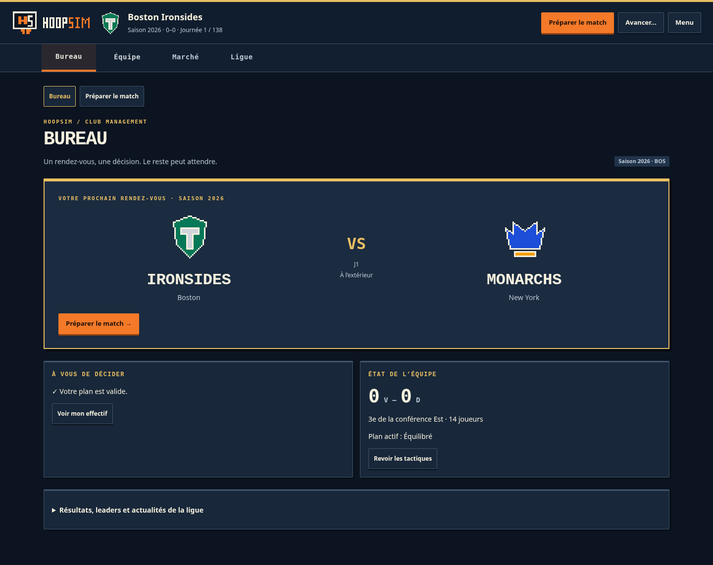
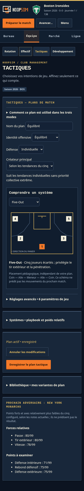

# Refonte UI Pixel Courtside — bilan des lots UI-0 à UI-7

Priorité : simplifier sans supprimer les commandes. Les mutations utilisent le store et les validateurs existants. Aucun changement dans `src/engine`, `src/match`, `src/state`, `src/assets/players`, package.json ou package-lock.json. Les anciennes sauvegardes gardent leur format.

## Ce qui change pour le joueur

- Bureau : prochain match, décisions et état de l’équipe ; résultats/leaders/actualité en détail.
- Équipe : effectif, rotation, tactiques et développement. Les brouillons ne sont appliqués que par Enregistrer.
- Marché : recrutement/contrats et draft. Les échanges et contrats ont une étape de vérification explicite.
- Ligue : calendrier, classement, statistiques, playoffs et histoire.
- Menu : sauvegarde/export/nouvelle partie, glossaire et outils (Animations et galerie).

## UI-0 — Inventaire et gel

Inventaire des 26 commandes store et contrôles de présentation. Docs management 0–6 présentes. Branche de travail existante `work`, état initial propre.

Composants / détails : [UI_FUNCTION_COVERAGE.md](UI_FUNCTION_COVERAGE.md).

Contrôles : [build : réussi](ui/UI-0-build.log), [test : réussi](ui/UI-0-test.log), [lint : réussi](ui/UI-0-lint.log).

Baseline et captures avant.

## UI-1 — Concept de marque

Logo HoopSim original en 6 variantes et 3 emblèmes pilotes nyk/mia/den. Registre UI indépendant des sauvegardes.

Composants / détails : [branding/STYLE_PREVIEW.md](branding/STYLE_PREVIEW.md).

Contrôles : [build : réussi](ui/UI-1-build.log), [test : réussi](ui/UI-1-test.log), [lint : réussi](ui/UI-1-lint.log).

Galerie de tailles et fonds, lecture visuelle du prototype.

## UI-2 — 30 franchises et design system

30 compositions éditables sur grille 32×32, palettes historiques. Tokens de management, panneaux, boutons, focus et modale partagée.

Composants / détails : [branding/BRAND_GUIDELINES.md](branding/BRAND_GUIDELINES.md).

Contrôles : [build : réussi](ui/UI-2-build.log), [test : réussi](ui/UI-2-test.log), [lint : réussi](ui/UI-2-lint.log).

validate-branding.ts : 30/30. Galerie et planche des 30.

## UI-3 — Navigation et Bureau

Quatre espaces ; outils dans Menu. Prochain rendez-vous, priorités réelles, bilan. Préparation avec cinq, scouting et trois modes. Avances regroupées et confirmations.

Composants / détails : [../src/ui/ManagementHome.tsx](../src/ui/ManagementHome.tsx).

Contrôles : [build : réussi](ui/UI-3-build.log), [test : réussi](ui/UI-3-test.log), [lint : réussi](ui/UI-3-lint.log).

smoke-ui et smoke-release : navigation et trois largeurs ; 3 modes conservés.

## UI-4 — Équipe et rotation

Cartes de joueurs, recherche/poste et tableau complet. Écran Rotation distinct, profils/bibliothèque et options de fin regroupées, état brouillon/annulation/confirmation de départ. Fiche joueur partagée.

Composants / détails : [../src/ui/tabs/RosterTab.tsx](../src/ui/tabs/RosterTab.tsx).

Contrôles : [build : réussi](ui/UI-4-build.log), [test : réussi](ui/UI-4-test.log), [lint : réussi](ui/UI-4-lint.log).

smoke-ui : ouverture/fermeture fiche, brouillon sans mutation, refus de quitter, annuler et enregistrer.

## UI-5 — Tactiques

Identité, défense et créateur visibles ; mini-terrain pédagogique de 6 systèmes. Six paramètres, poids relatifs et bibliothèque à la demande. Enregistrement toujours visible et validé.

Composants / détails : [../src/ui/tabs/TacticsTab.tsx](../src/ui/tabs/TacticsTab.tsx).

Contrôles : [build : réussi](ui/UI-5-build.log), [test : réussi](ui/UI-5-test.log), [lint : réussi](ui/UI-5-lint.log).

smoke-ui : attaque/défense/rythme sauvegardés, rotation inchangée ; parcours sans débordement.

## UI-6 — Marché et intersaison

Filtres secondaires repliés ; Donner/Recevoir, aperçu réel, vérification et confirmation ; contrat vérifié avant signature. Draft accessible depuis Marché, étapes et confirmations de délégation/passage.

Composants / détails : [../src/ui/tabs/MarketTab.tsx](../src/ui/tabs/MarketTab.tsx).

Contrôles : [build : réussi](ui/UI-6-build.log), [test : réussi](ui/UI-6-test.log), [lint : réussi](ui/UI-6-lint.log).

smoke-market : refus sans mutation, transfert unique, signature, prolongation, reload et match physique. smoke-development : focus, saison, draft et saison suivante.

## UI-7 — Ligue et finitions

Classement et statistiques essentiels/complets, tris au clavier et fiches, calendriers/résultats au clavier, tableaux défilants accessibles. Sauvegardes, outils et diffusion paresseuse Phaser préservés.

Composants / détails : [../src/ui/tabs/StatsTab.tsx](../src/ui/tabs/StatsTab.tsx).

Contrôles : [build : réussi](ui/UI-7-build.log), [test : réussi](ui/UI-7-test.log), [lint : réussi](ui/UI-7-lint.log).

smoke-release, smoke-ui, smoke-market, smoke-development ; contrôle 30 logos et diff des chemins protégés.

## Preuves finales

- [Couverture des commandes et contrôles](UI_FUNCTION_COVERAGE.md)
- [Parcours de découverte, brouillons, tactiques et responsive](ui/UI-7-smoke.log)
- [Recrutement et match après transfert](ui/UI-6-market.log)
- [Sauvegardes défaillantes et clavier en match](ui/UI-7-release.log)
- [Développement, draft et nouvelle saison](ui/UI-7-development.log)
- [30 identités de franchises](branding/franchise-contact-sheet.png)

## Reproduire

Serveur : `npm run dev -- --host 127.0.0.1 --port 5173 --strictPort`. Puis `npm run build`, `npm test`, `npm run lint`, `npx tsx scripts/validate-branding.ts`, `python scripts/smoke-ui.py`, `python scripts/smoke-market.py`, `python scripts/smoke-development.py`, `python scripts/smoke-release.py`. Playwright Python et Chromium système sont présents dans cet environnement. Les scripts navigateur utilisent des carrières de test dans leurs propres contextes navigateur, sans toucher à la carrière de votre navigateur habituel. Les preuves sont écrites sous `/tmp`. Galerie visuelle : paramètre `?branding`.

## Limites et arbitrages

- La direction graphique est proposée, sans validation artistique humaine ni test utilisateur chronométré. Les logos restent éditables.
- Le mini-terrain est pédagogique : il ne prédit ni possession ni résultat et ne modifie pas le plan.
- Aucun nouvel historique, moral, chimie, matchup, zone/press ou échange de choix de draft inventé. Les options réellement absentes restent absentes.
- Les tableaux financiers et la rotation restent défilants sur mobile pour préserver tous les champs ; les cartes effectif et les vues essentielles de ligue sont l’entrée simplifiée.
- L’accessibilité a été vérifiée au clavier dans Chromium (focus, Escape, abandon de brouillon, tables) ; il ne s’agit pas d’une certification WCAG ni d’un audit lecteur d’écran ou multi-navigateur.
- Compilation : avertissement de taille du chunk Phaser déjà présent avant refonte, sans échec.
- Les campagnes de calibration de dizaines de saisons ne sont pas relancées : moteur inchangé, suite complète et parcours réels exécutés.
